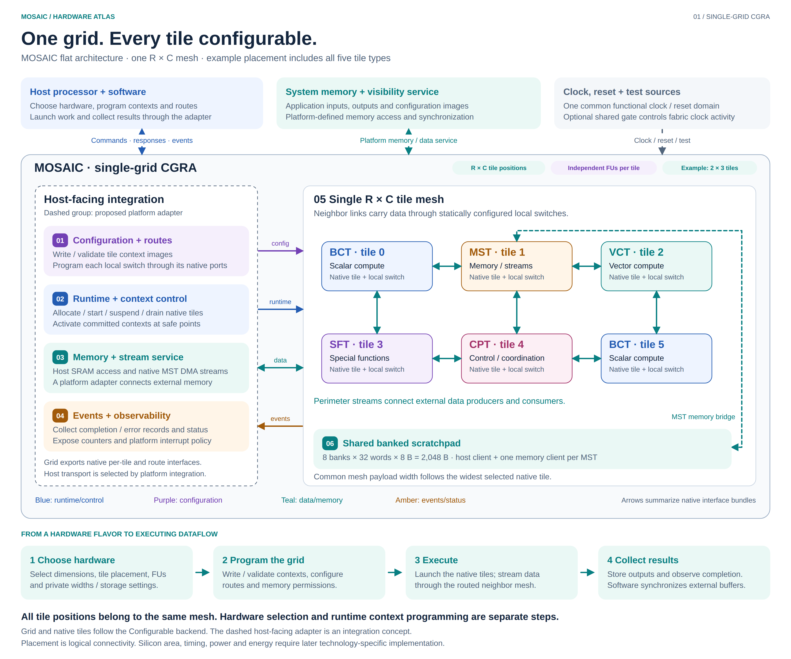
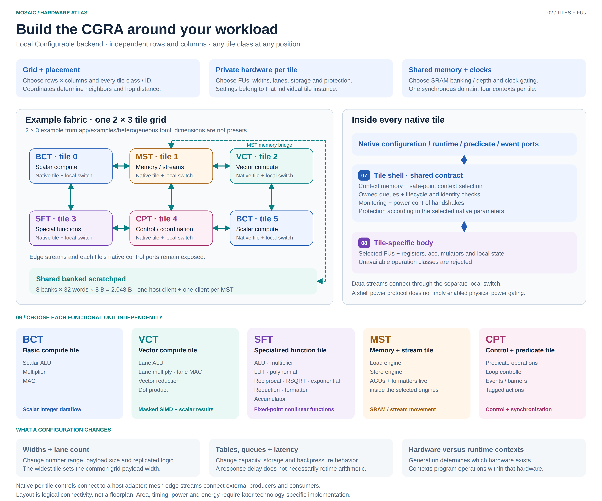

# MOSAIC architecture diagrams

These two views show MOSAIC as **one flat, configurable CGRA grid**. The first
places the grid alongside host integration, shared memory and platform services.
The second explains the shared tile shell and all five native tile classes. Both
use the same continuous mesh, with no cluster partitions or global packet NoC.

The grid, tiles, local switches and SRAM follow the existing **Configurable**
backend. The dashed host-facing group is an **integration concept**: it explains
how a platform could drive the native interfaces. It does not claim that a new
flat System-RTL wrapper or host protocol adapter has been implemented.

Download the [two-page PDF](mosaic-architecture.pdf) for presentations or printing.
Use the SVGs for editable vector graphics and the PNGs for slides or documents.
The drawings show logical organization and functional interface bundles, rather
than physical placement or individual RTL signals.

## 1. The MOSAIC top



[Editable SVG](mosaic-top.svg) · [High-resolution PNG](mosaic-top.png)

The example follows [heterogeneous.toml](../../app/examples/heterogeneous.toml):
a single **2×3 mesh** containing **two BCTs, one MST, one VCT, one SFT and one CPT**.
The upper row is BCT/MST/VCT; the lower row is SFT/CPT/BCT. Each position contains
one native tile and one `local_switch`. Seven neighbor connections carry
independent traffic in both directions between adjacent positions.

The shape is illustrative. Rows and columns are independent positive integers,
and the editor selects the tile class and hardware parameters at every position.
Every tile belongs to the same grid. Shared memory in this example contains
eight banks of 32 64-bit words, providing **2 KiB** of scratchpad SRAM.

| Figure label | Part | What it does and why it is needed |
| --- | --- | --- |
| External host | Processor and software | Choose the hardware flavor, map workloads, supply context images and routes, launch execution, and collect results. Software also manages external buffer visibility and synchronization according to the platform contract. |
| External memory | System memory and visibility service | Hold configuration images and application input/output buffers. External memory protocols, controllers and synchronization belong to the platform integration. No external bus width or protocol is prescribed by this figure. |
| External clocks | Clock, reset and test sources | Supply the common clock, active-low synchronous reset and test/scan controls. The configurable fabric can include a shared clock gate; enable must remain asserted while configuration and traffic need clocks. |
| **01** | Configuration and route control | The proposed host adapter writes and validates each tile's context images through native configuration ports and programs each local switch through its route-control ports. These direct interface bundles do not imply a dedicated configuration network instance. |
| **02** | Runtime and context control | The proposed adapter sequences allocation, start, suspend, drain and safe-point context activation through native per-tile handshakes. Tile classes retain their own command and context formats. Cross-tile scheduling and coordinated launch are integration/software responsibilities. |
| **03** | Memory and stream service | Connect the real host SRAM client, exposed MST DMA streams and mesh-edge streams to the platform's data services. The host-facing external-memory adapter is proposed; selecting a flavor does not instantiate the existing System-RTL memory mover. |
| **04** | Events and observability | Native tiles provide completion/error events, status and counters. The proposed adapter collects these records and applies the platform's result-notification and interrupt policy. Event queue depth, register layout and interrupt aggregation are not fixed by the fabric generator. |
| **05** | Single configurable mesh | Connect all tile positions through north/east/south/west neighbor links and statically configured local switches. The switches preserve ready/valid backpressure and support their configured routes. Perimeter links expose streaming ingress and egress. There are no cluster gateways or inter-cluster packetization stages. |
| **06** | Shared banked scratchpad | Provide real 64-bit SRAM banks with permissions and memory management. The fabric has one host client and one memory bridge/client per MST. The illustrated single-MST grid has two clients. More banks can separate bank accesses, while deeper banks only add capacity; bank and port contention still matter. |

The intended workflow is:

1. **Choose hardware:** set dimensions, tile classes/placement, independent FUs,
   widths and storage, then generate the corresponding RTL.
2. **Program the grid:** map the workload, write/validate native contexts, program
   switch routes and configure SRAM/MST permissions before admitting traffic.
3. **Execute:** start the native tiles and supply compatible streams. Tile results
   travel through the same neighbor mesh to their consumers and MST endpoints.
4. **Collect results:** observe completion, transfer outputs and synchronize
   external buffers under the platform adapter's contract.

Compute completion and host-visible output delivery are separate obligations.
The host adapter must account for outstanding writes and required visibility
operations before reporting a completed result. This figure does not prescribe
their implementation or claim a qualified end-to-end flat system campaign.

## 2. Configurable fabric, tiles and FUs



[Editable SVG](mosaic-tiles.svg) · [High-resolution PNG](mosaic-tiles.png)

This second view expands the same flat mesh and explains the native tile
organization. Tile class, ID and private hardware settings are explicit at every
position, within native identity and parameter constraints.

| Figure label | Part | Meaning |
| --- | --- | --- |
| **07** | Shared tile shell | Owns context storage/selection, lifecycle and ownership checks, boundary queues, monitoring and power-control handshakes. Context activation requires committed images and safe points. The integration ties the configuration and functional clocks to the same domain. Native shell capabilities do not mean that asynchronous operation or physical power gating is enabled in the fabric. |
| **08** | Tile-specific body | Implements the tile's operation decoding, selected FUs, registers, accumulators, state and result handling. It validates contexts/commands against the generated hardware. Internal helpers can remain for another enabled FU: disabling standalone multiply does not remove multiplication needed inside an enabled MAC. |
| **09** | Independent FU selection | Choose operation capabilities at generation/elaboration time. Each switch is independent, including all-off choices; explicit enables override legacy cumulative `FU_PROFILE` defaults. Loading a context cannot create a FU that was disabled in the hardware. |

**FU** means functional unit; **ALU** means arithmetic/logic unit; **MAC** means
multiply-accumulate; **SIMD** means one instruction applied across multiple data
lanes; **LUT** means lookup table; **RSQRT** means reciprocal square root; **AGU**
means address generation unit. **NoC** means network on chip; **MMIO** means
memory-mapped input/output; **IRQ** means interrupt request; **DMA** means direct
memory access; **SRAM** means static random-access memory. The tile names below
follow the specifications, including **CPT — Control and Predicate Tile**.

| Tile | Independently selectable FUs | Typical role and configuration implications |
| --- | --- | --- |
| **BCT — Basic compute tile** | Scalar ALU, multiplier, MAC | Scalar integer dataflow. Payload/accumulator width determines range and data size; multiplier operand width is separately selected. RF depth, accumulator count and queues add storage. An enabled MAC may retain internal multiply/add helpers. |
| **VCT — Vector compute tile** | Lane ALU, lane multiply, lane MAC, reduction, dot product | Masked integer SIMD and cross-lane results. Lane count replicates arithmetic and storage, and helps only if the workload and memory bandwidth feed the lanes. Native payload width is `NUM_LANES × ACC_WIDTH`, potentially widening every grid link. |
| **SFT — Specialized Function Tile** | ALU, multiplier, LUT, polynomial, reciprocal, RSQRT, exponential, reduction, formatter, accumulator | Fixed-point nonlinear approximations and exact operations. Table depth, coefficients and internal precision change storage and numerical behavior. Fraction bits trade integer range for resolution at fixed width. FUs share an ordered issue engine; enabling more FUs does not add independent issue engines. |
| **MST — Memory and Stream Tile** | Load engine, store engine | Move data between memory, DMA streams and tile streams. AGUs and formatters are internal to the selected engines. Channel/FIFO depths control buffering; more MSTs add clients that still share banks and fabric bandwidth. The current adapter requires width conversion; circular addressing is unavailable. |
| **CPT — Control and Predicate Tile** | Predicate operations, loop controller, events/barriers, tagged actions | Conditional execution, iteration, synchronization and coordinated actions. Loop/event/action capacities determine supported state and outstanding work. Tagged actions need external peers implementing the matching protocol. |

The editor's **Generate RTL** step chooses the hardware: geometry, placement,
FU availability, widths, storage, queue depths and protection. **Runtime contexts**
then select operations, operands, routes or programmed tables within that hardware.
Four native context slots are fixed by the current adapter. A latency setting can
delay a response without splitting an arithmetic critical path; it is not a general
promise of a higher clock frequency.

The existing generator names the exported module `cluster` and the TOML group
`[cluster]`; in the Configurable backend these names identify the **whole flat
grid**, not subgroups of tiles. The drawing uses functional names and does not
rename the RTL or schema. Each tile retains native configuration/runtime/
predicate/event/power/status ports, with separate switch-route controls.

The compiler/host must program compatible formats and routes. Narrow receivers
stall and report a width error when upper payload/metadata bits do not fit; data
is not silently truncated. Native controls and mesh-edge streams connect the
fabric to the proposed platform adapter and external peers.

See the [full configuration reference](../../app/configuration.md) for every
parameter, choice and implication. Resource, timing and energy trade-offs here
are qualitative. The figures make no synthesis, floorplan, timing, area, power or
energy claim.

## Sources and regeneration

Flat fabric sources:
[example placement](../../app/examples/heterogeneous.toml),
[local editor contract](../../app/README.md),
[fabric generator](../../src/gen/flavor/fabric.py),
[configuration guidance](../../src/gen/flavor/guidance.py), and
[native tile shell contract](../../src/val/mosaic_blocks/tile_shell/README.md).

Tile specifications:
[BCT](../../../specs/mosaic-blocks/mosaic-bct/README.md),
[MST](../../../specs/mosaic-blocks/mosaic-mst/README.md),
[VCT](../../../specs/mosaic-blocks/mosaic-vct/README.md),
[SFT](../../../specs/mosaic-blocks/mosaic-sft/README.md), and
[CPT](../../../specs/mosaic-blocks/mosaic-cpt/README.md).

The separately implemented [System-RTL profile](../../src/gen/system/README.md)
still uses its existing cluster hierarchy. It is outside these single-grid
drawings; replacing the diagrams does not change that RTL integration.

From the repository root:

```sh
# Editable SVGs; Python 3.12 standard library only.
.venv/bin/python doc/architecture/render.py

# Also export 3600 × 3000 PNGs and a two-page vector PDF.
# Requires the existing optional Playwright / Chromium browser-check installation.
.venv/bin/python doc/architecture/render.py --export
```

The renderer reads the heterogeneous example and guards its illustrated placement
and memory-bridge path. It checks browser text bounds during export and makes no
changes to generated RTL or application configuration. If the example changes,
update the explanatory layout and documentation together.
